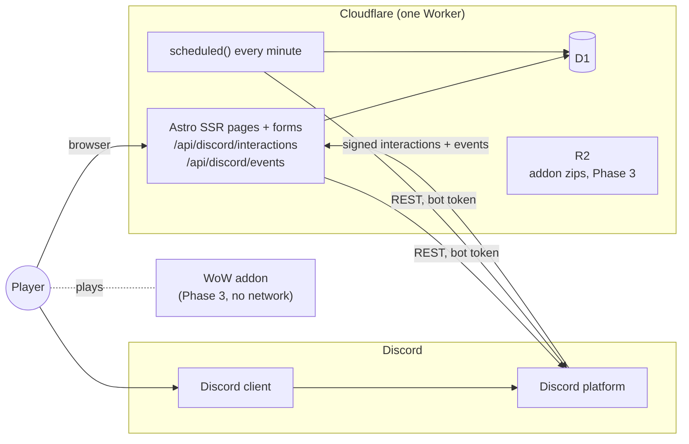
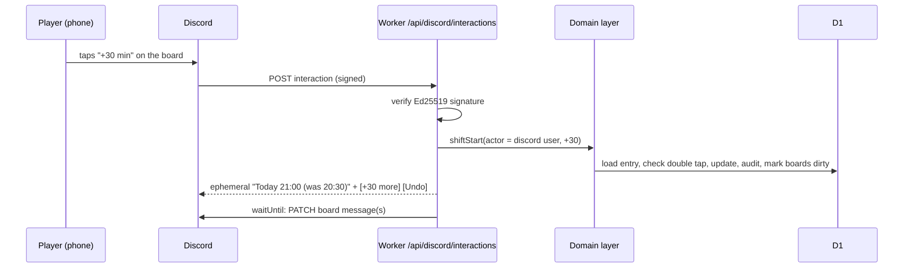

# Party Planner — System Architecture

> Requirements: [prd.md](prd.md). Brief: [product-brief.md](product-brief.md). Distribution: [distribution.md](distribution.md).
>
> **Status:** v0.2, 2026-10-23. Stack changed from Next.js + Supabase to **Astro + Cloudflare Workers + D1** to make hosting fast, simple and cheap (§3). Covers Phase 1 in detail and marks where Phases 2–3 attach. Items in §10 must be checked against current platform docs before relying on them.

## 1. Shape of the system

**One Cloudflare Worker and one D1 database.** No always-on bot process, no separate API server, no external database or cron service.

- The Worker runs the **Astro** website (server-rendered pages), the **Discord interactions endpoint**, and a **cron trigger** every minute for background work.
- Discord talks to us over **HTTP interactions** (signed webhooks). We talk to Discord over its REST API with the bot token. Slash commands, buttons, menus, modals and editing our own board message need nothing else, so we skip the Discord gateway (WebSocket) entirely.
- **D1** (Cloudflare's SQLite database) is reached only through the Worker's binding. It has no public endpoint and no connection string.
- The **WoW addon** (Phase 3) has no network connection to us. It's a separate client that runs inside the game.



## 2. Components

| Component | Where | Responsibility |
| --- | --- | --- |
| **Web UI** | `apps/web/src/pages` | Astro pages rendered on the server. Plain HTML forms posting to the same Worker, so pages work with almost no JavaScript; small interactive pieces only where they clearly help (the week grid on a phone). |
| **Worker entrypoint** | `apps/web/src/worker.ts` | `fetch` → Astro; `scheduled` → the minute tick |
| **Domain rules** | `packages/domain` | Pure rules: time handling, resolving availability, sharing, best start time. No framework or Cloudflare imports, unit-tested on its own. |
| **Use cases** | `apps/web/src/lib/server` | Groups, availability, users, sessions. Each function takes the acting user and does the **authorization** check itself, so pages, Discord handlers and jobs share one enforcement point. |
| **Data access** | `packages/db` | Drizzle schema and queries for D1. SQL migrations generated by drizzle-kit, applied by wrangler. |
| **Discord adapter** | `apps/web/src/lib/discord` | Signature check, interaction routing, replies, board rendering, install links, REST client, command registration script |
| **Auth** | `apps/web/src/lib/server/session.ts`, `src/pages/auth/` | Discord OAuth (authorization code flow, scope `identify`) for the website. Sessions in D1; the cookie holds a random token, the database stores only its SHA-256. A `/auth/dev` login exists only in `astro dev` (`import.meta.env.DEV`), so local work needs no Discord app. |
| **Jobs** | `apps/web/src/lib/jobs` | Board sweep, day rollover, digests, reminders, outbox delivery, retention cleanup. Each one idempotent. |
| **D1** | Cloudflare | Single source of truth |
| **R2** | Cloudflare (Phase 3) | Addon releases; public read, CI write |

## 3. Technology choices

| Choice | Why | Alternatives considered |
| --- | --- | --- |
| **Astro (SSR) on Cloudflare Workers** | The website is a handful of simple, mostly server-rendered pages with forms. Astro does that with very little JavaScript, fast on phones. Its Cloudflare adapter supports a custom Worker entrypoint, so the site, the Discord endpoint and the cron job ship as one Worker with one `wrangler deploy`. | **Next.js**: more framework than these pages need and harder to host outside Vercel. **Hono + a small SPA**: also good, but we'd build page rendering ourselves. **SvelteKit**: comparable; Astro's server-first defaults fit better. |
| **Cloudflare D1** | Same platform as the Worker, free tier is far beyond our needs, nothing pauses when idle, local dev runs the same engine. | **Supabase Postgres**: also free, but adds a second vendor, a connection pooler, and the free tier pauses inactive projects. If we outgrow D1, the move is to Postgres (e.g. Neon via Hyperdrive); the schema avoids SQLite-only tricks. |
| **Cron Triggers** | Built into Workers, call `scheduled()` in the same Worker, no secret endpoint needed | pg_cron, external cron services |
| **Own auth (Discord OAuth + D1 sessions)** | Discord login is one OAuth flow and a session table. No auth vendor needed. | Supabase Auth, Auth.js/better-auth. Revisit if we add email login or more providers. |
| **Drizzle ORM** | First-class D1 support, typed queries, generates SQL migrations | Kysely (no D1 migration story), raw SQL |
| **pnpm workspace monorepo** | Domain code shared by pages, Discord handlers and jobs, and testable on its own; addon lives in the same repo later | Single package |

## 4. Core model decisions

The schema is in [packages/db/src/schema.ts](../packages/db/src/schema.ts). These are the rules it follows.

### 4.1 Users are ours, logins are just a way in
`users` is our own table. `user_identities(provider, external_id)` holds Discord IDs (later game identities). Website sessions point at a user.
- A **Discord-only user** is created on their first interaction: a `users` row + `user_identities(discord, <id>)`.
- When someone logs in on the website with Discord, we look up `user_identities(discord, <id>)`, so it's the same person and the same data.
- Email login is not in the first release (every pilot user is on Discord). Adding it later means an email provider and a merge flow for people who already have a Discord-only profile.

### 4.2 Availability belongs to the user, groups get a view of it
An availability entry is `(user, gaming_day)`, **not** `(user, group, date)`. Sharing decides which groups can see it (`packages/domain/src/sharing.ts`):

```
visible_in_group(entry, G) =
      membership(entry.user, G) exists
  and membership.share_availability = true
  and (entry.share_scope = 'all_shared_groups' or G ∈ entry.share_groups)
```

Weekly defaults follow `membership.share_availability` only.

**Effective availability** for a user and day = explicit entry, else their weekly default for that weekday, else *unknown*. Defaults are computed when read, not copied into rows, so changing a default affects every future day without an explicit entry. Results carry `kind = explicit | default` so the UI can show them differently.

Hidden and unanswered both show as *unknown* to others. That's deliberate: nobody can tell that someone hid something from them.

### 4.3 Three separate concepts
| Concept | Meaning | Stored as |
| --- | --- | --- |
| **Availability** | "I could play Wednesday from 20:30" | `availability_entries`, `weekly_defaults` |
| **RSVP** (Phase 2, N1) | "I'm coming to Wednesday's dungeon run" | `sessions`, `session_rsvps` (later) |
| **Free now** | "I'm free right now, until 23:00" | `free_now` with `expires_at` (expired rows are ignored when read; no job needed) |

### 4.4 Provenance on everything that changes
Every availability change, and later every character/progress record, stores `source` (`web`, `discord`, later `manual`, `addon`, `api`) and an update time. An `availability_events` audit table will keep the history.

### 4.5 Game version is a first-class field (Phase 2)
Characters carry `game_version`/`ruleset`, `realm` and `faction`. Matching never compares characters across versions. Values come from a lookup table so we can add the "WoW Forever" ruleset once it's confirmed.

## 5. Trust boundaries and authorization

| # | Boundary | Who's on the other side | How we trust it |
| --- | --- | --- | --- |
| B1 | Browser → Worker | Logged-in user | Session cookie (`HttpOnly`, `Secure`, `SameSite=Lax`), token hashed in D1. Astro's origin check rejects cross-site form posts. |
| B2 | Discord → `/api/discord/interactions` and `/events` | Discord, on behalf of a Discord user | **Ed25519 signature check** with the app's public key on every request, before parsing. Reject on failure. The Discord user ID in a verified payload identifies the user. |
| B3 | Worker → Discord REST | Discord | Bot token, a Worker secret |
| B4 | Cron → `scheduled()` | Cloudflare | Not an HTTP route, so nothing to protect |
| B5 | Worker → D1 | — | Binding only; D1 has no public endpoint or credentials |
| B6 | WoW addon (Phase 3) | Player's machine | Not connected. Anything that comes from it later (peer messages, a companion app) is **self-reported and unverified** and gets labelled as such. |
| B7 | CI → R2 (Phase 3) | Our release pipeline | Scoped API token; checksums published with each release |

### 5.1 One place for authorization
Every use case takes an **actor** and checks permissions in the domain layer:

- `User(user_id)`: a person, from a website session or a verified Discord interaction.
- `Board(group_id)`: the audience of a linked Discord channel. Can read the group week view exactly like a member, can't write anything.
- `System(job)`: background jobs, limited to what each job needs.

Rules:
- Group data is only readable by actors who are members of that group (or that group's Board).
- A user can only change their own availability, free-now status and settings.
- Admin actions (invites, board setup, member removal, group settings) need the admin role **in our database**. Discord server roles don't count, with one addition: `/board setup` also requires Manage Channels in that channel, so people can't post boards in servers they don't moderate.
- **Being in a Discord server never makes you a member of a group.** Board buttons from non-members get the join prompt (PRD M8).
- Component `custom_id`s are never trusted for authorization. They're decoded, and the actor and target are checked again.

### 5.2 Leak tests (must exist before the pilot)
Integration tests against a real local D1:
- An entry limited to group A isn't returned by any group-B query, board render, digest or `/who`.
- With `share_availability = false`, group counts and the best start time leave the user out, and they show as *unknown*.
- Leaving a group removes the user from that group's views at once; their own entries remain.
- A Board actor for group A can't read group B, even if both are linked to channels in the same server.
- Membership of a private group never appears in another group's member lists or responses.

### 5.3 The board is public to its channel
Everything on a board is visible to everyone who can see that channel, including people who aren't group members. `/board setup` says so and asks the admin to confirm. Boards show display names, statuses and times; never notes, other groups or anything from personal settings.

## 6. Key flows

### 6.1 Update availability on the website
1. A form posts `{day, status, start, end?, share}`.
2. Domain: actor = session user; validate; resolve local time → UTC with the user's timezone (§7).
3. Upsert `availability_entries`, append to `availability_events` (`source = web`).
4. Mark the boards of every group that can see this entry as dirty.
5. `ctx.waitUntil(...)`: try to refresh those boards right away (§6.4). Redirect back to the page, which renders the new state.

### 6.2 `/avail` in Discord
1. Discord POSTs the interaction. Verify signature.
2. Resolve the actor from the Discord user ID; create a Discord-only user on first use (§4.1). No timezone yet → reply with the timezone picker first.
3. Reply **ephemeral**: the week planner with a day selector, Yes/Maybe/No and start presets. Custom time opens a modal.
4. Each press is a component interaction → same use case as §6.1 with `source = discord` → reply by updating the ephemeral message so the planner shows the new state.

Discord expects an answer within 3 s. D1 writes finish well inside that. Anything slower gets a deferred response first and an edit afterwards.

### 6.3 "+30 min" without double moves
The board is shared, so its "+30 min" button can't carry a per-user target time. Rules:
- A **relative** shift (board button or `/delay`) applies to the user's entry for the current gaming day (§7).
- A second relative shift on the same entry within **5 s** is ignored as a double tap (`last_relative_shift_at` on the entry).
- The ephemeral reply says "Today: 21:00 (was 20:30) · shared with The Dads" with **[+30 more]** and **[Undo]** buttons. These carry **absolute** targets in their `custom_id`, so pressing them twice gives the same result.
- `/delay` deduplicates on the interaction ID as well.



### 6.4 Board refresh
- `discord_boards(group_id, guild_id, channel_id, message_id, dirty_since, last_rendered_at, last_render_hash)`.
- Changes set `dirty_since`. Refresh renders the board as the `Board(group)` actor, compares a hash of the content, and edits the message only if it changed.
- Refresh runs right after the change (`waitUntil`), and the minute tick sweeps anything still dirty (failed, rate-limited, or skipped).
- Respect Discord's rate limits (`429` + `retry_after`). Several changes inside the same few seconds collapse into one edit.
- If the board message was deleted (`404`), post a new one and store the new ID; if the channel is gone or permissions removed, mark the board broken and tell admins on the website.

### 6.5 Install and uninstall events
`/api/discord/events` receives Discord webhook events (signed like interactions). App authorized / deauthorized events update an installations table, and the website shows install status. Handled idempotently using the event's ID.

### 6.6 Notifications
Use cases never send messages themselves. They write to an **outbox** table with a unique `dedupe_key` (e.g. `freenow:{group}:{sender}:{2h-bucket}`). The tick sends pending rows and marks them sent. This gives us the PRD's rate limits, quiet hours and opt-outs in one place, and nothing gets sent twice after a retry.

## 7. Time and timezones

Implemented in [packages/domain/src/time.ts](../packages/domain/src/time.ts) using only `Intl`, so it runs the same in Workers and Node.

- **Stored for each entry:** `local_date` (the gaming day), `start_local` (wall time), `end_local` (nullable), `tz` (IANA, e.g. `Europe/Copenhagen`), and the derived `starts_at` / `ends_at` (UTC epoch ms).
- The wall time and timezone are what the user meant. UTC instants are for comparing across members. If tz rules change, the UTC values are recomputed from the wall time.
- **Gaming day:** a day runs from 05:00 to 05:00 local. "Today" at 00:30 is still last night's session, a window of 21:30–00:30 belongs to the day it started on, and a start of 01:00 on Wednesday means early Thursday morning. Boards roll over at 05:00 in the group's timezone.
- **DST:** a wall time that doesn't exist (spring forward) moves forward by the length of the gap (02:30 → 03:30); an ambiguous one (fall back) uses the first occurrence. Both are unit-tested.
- **Weekly defaults** store weekday + wall times + tz and are converted for each date when read, so 21:00 stays 21:00 across DST changes.
- **Views:** website shows the viewer's timezone; the board shows the group's timezone and says which one.
- **Best start time** (PRD §5.1, [best-start.ts](../packages/domain/src/best-start.ts)): the earliest qualifying time is always some member's start time, so we check each start and count members covering `[t, t + min_overlap]`. Pure and unit-tested.

## 8. Jobs (`scheduled()`, every minute)

| Job | When | Idempotency |
| --- | --- | --- |
| Board sweep | Every tick | Content hash; only dirty boards |
| Board day rollover | 05:00 in each group's timezone | Marks boards dirty; the sweep does the work |
| Outbox delivery | Every tick | `dedupe_key` unique + `sent_at` |
| Tonight digest | Group's chosen time | Writes outbox row `digest:{group}:{date}` |
| Sunday "fill next week" reminder | User's chosen time | Outbox row `remind:{user}:{iso-week}` |
| Retention cleanup | Daily | Deletes past entries/events older than 90 days |

`job_runs(job, period_key)` with a unique constraint prevents a job running twice for the same period. Each tick has a time budget and leaves the rest for the next one.

## 9. Deployment, environments and cost

| Environment | How |
| --- | --- |
| Local | `pnpm dev`: Astro dev server running in `workerd` with a local D1 (`pnpm db:migrate:local`). Discord dev app pointed at a tunnel (e.g. `cloudflared tunnel`) for interactions. |
| Production | `pnpm deploy` (build + `wrangler deploy`), `pnpm db:migrate:remote` for migrations |
| Staging | Later: a second Worker + D1 (`wrangler` environment) when there's more than one person deploying |

- **Cost:** €0 on the Workers Free plan for the pilot (requests, D1 storage and reads are far below the free limits). The thing to watch is the Free plan's small CPU budget per request. If page rendering hits it, Workers Paid is $5/month.
- **Secrets** (`wrangler secret put`, `.dev.vars` locally): `DISCORD_BOT_TOKEN`, `DISCORD_CLIENT_SECRET`. Plain vars in `wrangler.jsonc`: `DISCORD_CLIENT_ID`, `DISCORD_PUBLIC_KEY`, `PUBLIC_BASE_URL`.
- **Discord commands** are registered by a small script (global for production, guild-scoped for the dev app so changes show instantly).
- **Observability:** Workers logs with structured JSON lines and a request ID per interaction; a website admin page for broken boards and failed outbox rows.

### CI and tests
Kept fast on purpose: GitHub Actions runs `pnpm typecheck` and `pnpm test` on pushes and PRs (about a minute). No deploy pipeline yet; deploys are manual.

- **Now:** domain unit tests (time/DST, effective availability, sharing, best start) and Discord tests (signature check, PING, install links).
- **Now:** D1 integration tests in `apps/web/test`, including the leak tests in §5.2 and weekly defaults. They run against a real local D1 from wrangler's `getPlatformProxy` (not persisted to disk).
- **Later:** a deploy job on `main`, a staging environment, Playwright smoke tests.

## 10. Integration assumptions to verify

| Platform | Assumption we rely on | Status / fallback |
| --- | --- | --- |
| Astro + Cloudflare | Custom Worker entrypoint can export `scheduled` next to Astro's `fetch` | **Verified locally** (preview runs the tick) |
| Discord | HTTP interactions endpoint works without a gateway connection for commands, components, modals and editing our own messages | Fallback: small gateway worker elsewhere |
| Discord | Initial response within 3 s; follow-ups possible for 15 min with the interaction token | Defer more replies |
| Discord | User-installable apps (`integration_types`, `contexts`) let `/avail`, `/play`, `/delay` work in servers without the bot and in DMs | Guild install only; website for everyone else |
| Discord | App authorized/deauthorized webhook events exist and are signed | Record installs from the OAuth redirect; detect removal from 403/404 on board edits |
| Discord | Component limits fit the planner (classic 5 rows × 5 buttons, or Components V2) | Day select menu + 1 row of status buttons |
| Discord | The bot can DM a user for reminders (shared server, or user install) | Post in the board channel, or website-only reminders |
| Cloudflare | Free plan CPU budget per request is enough for our pages | Workers Paid ($5/month) |
| Cloudflare | Free plan cron triggers can run every minute | Coarser schedule; boards still refresh right after each change |
| WoW | Not used in Phase 1 | — |

## 11. Repository layout

```
apps/web/                         Astro app = the one Worker
  src/worker.ts                   fetch → Astro, scheduled → tick
  src/pages/                      website pages
  src/pages/api/discord/          interactions (and events, later)
  src/lib/discord/                verify, interactions, install links
  src/lib/jobs/                   minute tick
  wrangler.jsonc                  bindings, cron, vars
packages/domain/                  time, availability, best start, sharing (pure TS + tests)
packages/db/                      Drizzle schema, migrations/
addon/                            WoW addon (Phase 3)
docs/
.github/workflows/ci.yml          typecheck + tests
```

## 12. How later phases attach

- **Phase 2 (characters, discovery):** new tables (`characters`, `character_group_visibility`, `friendships`, `discovery_settings`) and use cases in the same domain layer. Discovery queries return **counts and opted-in identities only**, through their own read model so they can't reach group-private data by accident.
- **Phase 3 (addon):** the addon is its own product in `addon/`, built by CI and published to R2 (and CurseForge/Wago) as in [distribution.md](distribution.md). It works with no account. If sync is added later (supported game API on the server, or a companion app reading SavedVariables), it comes in through a new boundary with its own credentials and writes progress with `source = addon`/`api`, never overwriting newer manual data without a rule for it.

## 13. Decision log

| # | Decision | Reason |
| --- | --- | --- |
| A1 | HTTP interactions, no gateway bot | Serverless, nothing to babysit, fewer permissions |
| A2 | Database only reachable through the Worker; domain layer authorizes | One enforcement point shared by website, Discord and jobs |
| A3 | Own `users` table, logins are identities | Discord-only users without a website login |
| A4 | Availability per user, shared to groups | Enter once, share selectively (user stories 3, 6) |
| A5 | Store wall time + IANA tz + UTC | Correct across DST and multiple timezones |
| A6 | Gaming day 05:00–05:00 | Late sessions belong to the evening they started |
| A7 | Minute cron trigger + outbox | Reliable background work and no duplicate notifications |
| A8 | One Worker for site, Discord and jobs | One deploy, nothing else to run |
| A9 | Astro instead of Next.js (2026-10-23) | Simple server-rendered site; easier and cheaper to host on Workers |
| A10 | D1 instead of Supabase Postgres (2026-10-23) | Same platform, free, never pauses. Brief suggested Postgres; schema kept portable so we can move if needed. |
| A11 | Discord-only login in the first release | Every pilot user has Discord; email login needs an email provider and a merge flow |
| A12 | Fast CI only (typecheck + tests), manual deploys | Build fast now; add deploy and longer pipelines later |
